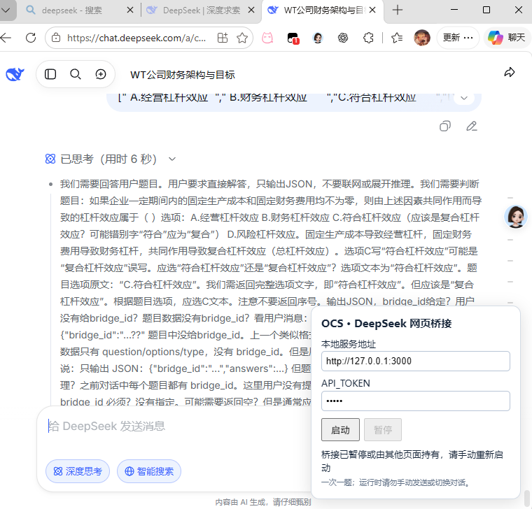
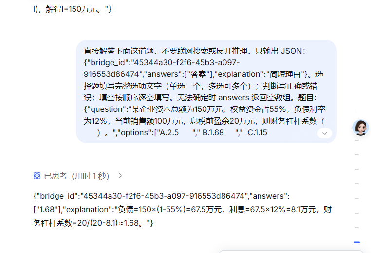

# OCS 免费搜题题库（DeepSeek 网页版）

为 OCS 提供本地部署的 DeepSeek 搜题题库：默认网页桥接模式把题目发送到你已登录的 DeepSeek 网页，无需 DeepSeek API Key；另提供需要付费的官方 API 模式。它不是预置静态题库，答案由 DeepSeek 根据题目生成（作者是懒狗，readme都要用AI写，要是不理解的部分直接问叭，然后里面很AI的表述大家也通融一下，谢谢喵）。

> **部署方式：每位使用者都要在自己的电脑部署并运行这套服务。** 作者不提供或代运行公共后端（自己电脑跑啦，都上GIThub了自己配置一下很简单的），也不需要把 OCS 指向我的服务器；GitHub 仓库只提供代码和配置示例。自己的 OCS、Node.js 服务和已登录 DeepSeek 的浏览器在同一台电脑上协作，默认地址是 `http://127.0.0.1:3000`。

> **费用说明：** Windows 和 Linux DeepSeek 网页桥接模式都不需要购买 API，也不向项目作者付费，希望能帮大家省一些搜题费用。另提供无需浏览器的 DeepSeek 官方 API 后端，但 API 会按 token 计费，**不推荐作为默认方案**。网页服务可用性与规则由 DeepSeek 决定；本项目不保证第三方服务永久免费或始终可用。（梁子不让用脚本抓网页内容，但是我们偷偷的抓应该没事的）

> **配置提醒：** OCS 配置中的认证头必须写成 `Bearer 你的口令`，其中 `Bearer` 和口令之间有一个空格。请保留这个空格，并将示例口令替换为你自己的 `API_TOKEN`。（这个空格是AI写代码的时候加上的，作者觉得实在逆天但是懒得改了）

本项目由 AI 辅助编写，仍需要真实使用者测试和反馈。由于我之后未必还有网课任务，项目不一定会持续更新。欢迎目前有网课任务的同学参与测试，也欢迎有兴趣的开发者接手改进或继续开发；可以通过 GitHub Issues、Pull Requests 或 QQ：1315528099 联系和贡献。（已经不用再上网课力，没东西测试了）

兼容 OCS 4.15.3 和 5.1.0 的 `/search` 题库接口；网页端操作由单独的油猴桥接脚本完成。（简单来讲就是一个网页脚本模拟题库，然后给蓝色肥鱼发问题代替题库搜题，什么？现在题库都要付费，我是学生能先给我转50吗）

```text
OCS 题目 → 本机 Node.js 队列 → DeepSeek 网页桥接油猴脚本
         ← OCS 格式答案    ← 网页生成的回答
```

## 运行界面



截图用于展示桥接面板的位置和配置项。截图时面板显示“桥接已暂停或由其他页面持有”，因此不是成功连接的证明；正常运行时应显示“已连接，等待 OCS 题目”，且 `/health` 返回 `connected: true`。

Windows 油猴模式只需要 Node.js 22+，无需安装 npm 依赖。Linux 无头模式另需 Playwright 和 Chromium；首次登录/验证码由用户人工完成，之后使用专用浏览器会话在后台运行。三种模式的选择如下：

| 模式 | 启动方式 | 是否需要 API Key | 浏览器 |
| --- | --- | --- | --- |
| Windows 油猴桥接 | `node --env-file=.env server.mjs` + 网页面板启动 | 否 | 自己打开 DeepSeek 网页 |
| Linux 无头网页桥接 | 同一服务 + `npm run linux:start` | 否 | 后台 Chromium，人工初始化登录 |
| 官方 API 后端 | `BACKEND=deepseek-api` + 同一服务 | 是，向 DeepSeek 付费 | 不需要 |

两种网页 worker 都使用 `BACKEND=web-bridge`。一个服务同一时间只连接一个 worker，不要同时启动 Windows 油猴面板和 Linux worker。

Linux 浏览器模式也不购买 DeepSeek API；若服务在自己的 Linux 服务器、OCS 在 Windows 上，可用下文的 SSH 隧道连接。日常无头运行可以没有桌面环境，首次人工登录仍需要临时显示浏览器。

## 网页答题示例

下面截图展示 DeepSeek 网页收到题目后，按提示返回带有 `answers` 和 `explanation` 的 JSON。它用于说明网页侧的答题格式；完整流程还需要本地服务、油猴桥接脚本和 OCS 题库配置都已启动并连接。DeepSeek 生成答案可能有误，请自行核对。



## 1. 获取项目并启动本地服务

先安装 Node.js 22 或更高版本、Git、Tampermonkey 和 OCS 主脚本（兼容 4.15.3/5.1.0），并准备一个已登录 DeepSeek 的 Chrome 或 Edge。此仓库提供本地桥接服务和配套油猴脚本，不包含 OCS 主脚本；请从 [OCS 官方项目](https://github.com/ocsjs/ocsjs) 安装。再打开 PowerShell 克隆本项目：

```powershell
git clone https://github.com/XuanHanHan/ocs-free-question-bank.git
cd ocs-free-question-bank
node --version
if (-not (Test-Path .env)) { Copy-Item .env.example .env }
```

确认 `node --version` 输出为 `v22` 或更高版本。条件复制只会在首次运行时创建 `.env`，不会覆盖已有口令。

`API_TOKEN` 是你自己设置的本地连接口令，不是 DeepSeek API Key。只在自己电脑上使用时，设成一段自己容易辨认的简单文字即可，例如 `OCS-1234`；不需要很复杂。记住这段文字，后面要在油猴面板和 OCS 配置中填入完全相同的值。若你希望使用更难猜的口令，也可以用下面命令随机生成：

```powershell
node -e "console.log(require('node:crypto').randomBytes(24).toString('hex'))"
```

选择简单口令（例如 `OCS-1234`），或者复制随机命令的输出，然后打开 `.env`：

```powershell
notepad .env
```

`.env` 内容：

```dotenv
BACKEND=web-bridge
API_TOKEN=OCS-1234
PORT=3000
JOB_TIMEOUT_SECONDS=150
DEEPSEEK_API_KEY=
DEEPSEEK_MODEL=deepseek-flash
```

使用 `web-bridge` 模式时，`DEEPSEEK_API_KEY` 留空即可；`DEEPSEEK_MODEL` 只在官方 API 模式中使用。服务固定监听 `127.0.0.1`，不直接开放公网端口。

启动：

```powershell
node --env-file=.env server.mjs
```

终端保持运行。修改代码或 `.env` 后，先 Ctrl+C 停止旧服务再启动。

## 2. 安装 DeepSeek 网页桥接脚本

1. 在已安装 Tampermonkey（油猴）的 Chrome 或 Edge 中，打开油猴管理面板，选择「添加新脚本」。
2. 将本目录 **deepseek-bridge.user.js 的全部内容**粘贴进去，替换默认内容，保存。
3. 打开或刷新 https://chat.deepseek.com/，登录自己的账号，打开一个专门用于 OCS 的空白对话。
4. 网页右下角应出现「OCS · DeepSeek 网页桥接」面板。地址保持 `http://127.0.0.1:3000`，填写与 `.env` 相同的 API_TOKEN。
5. 点击「启动」，看到「已连接，等待 OCS 题目」。油猴如提示连接本机地址，允许即可。

这是新增的第二个油猴脚本，原来的 OCS 脚本仍需保留。API_TOKEN 是本地服务口令，不是 DeepSeek 密钥，会保存在油猴脚本的独立设置中。

Codex 内置浏览器中的登录与 Chrome/Edge 的登录相互独立。正式使用时需要在**安装了油猴的浏览器**登录 DeepSeek；桥接脚本无须 Codex 保持运行。

## 3. 配置 OCS

1. 打开 **ocs-config.json**，把 `Bearer 替换为你自己的随机口令` 改成与 `.env` 中 `API_TOKEN` 相同的值。注意必须保留 `Bearer` 后面的一个空格，例如 `Bearer abc123`；不要把真实口令提交到公开仓库。
2. 将整个 JSON 数组粘贴到 OCS「通用 → 全局设置 → 题库配置」，选择默认解析器并保存。
3. 查询线程数设为 **1**。在高级设置中将「搜题最大耗时（秒）」设为 **180**（脚本支持的上限），长于本地默认的 150 秒。
4. 先使用 OCS 的在线搜题功能测试，或手动调用下方接口。

若已有旧的 `/search` 配置且本地口令和端口未改，可以继续使用。端口改变时，同时修改 `.env`、桥接面板地址和 OCS 配置 URL。

脚本已声明 `@connect 127.0.0.1` 和 `localhost`；使用 `GM_xmlhttpRequest` 跨域访问本机，无需开放 CORS。

## 手动测试

服务与网页桥接均已启动后，在另一个 PowerShell 终端运行（口令换成自己的）：

```powershell
$body = @{
  question = '哪些是质数？'
  options = @('2', '3', '4')
  type = 'multiple'
} | ConvertTo-Json
Invoke-RestMethod -Uri 'http://127.0.0.1:3000/search' `
  -Method Post -ContentType 'application/json; charset=utf-8' `
  -Headers @{ Authorization = 'Bearer 你的实际口令' } -Body $body
```

DeepSeek 网页会自动出现题目。成功响应示例：

```json
{"code":0,"message":"success","data":[{"question":"哪些是质数？","answer":"2#3","explanation":"2和3是质数。"}]}
```

`options` 支持字符串数组或换行分隔字符串；`type` 支持 single、multiple、judgement、completion、unknown。题目和选项会发送到你的 DeepSeek 网页对话并留在聊天记录中。

## 保姆级演示：从安装到 OCS 实际搜题

以下步骤以 Windows、Chrome/Edge、PowerShell 和本机默认地址 `127.0.0.1:3000` 为例。**每个人都需要在自己的电脑完成这些步骤**：自己的 OCS 连接自己的 Node.js 服务，自己的浏览器登录自己的 DeepSeek 账号。服务、DeepSeek 浏览器和 OCS 必须运行在同一台电脑上。第一次配置请按顺序完成；之后使用时只需启动服务、启动网页桥接，再打开 OCS。

### 第一步：准备依赖和账号

需要准备：

1. **Node.js 22 或更高版本**：运行本地题库服务。可从 [Node.js 官网](https://nodejs.org/) 安装 LTS 版本，安装后重新打开 PowerShell。
2. **Git**：下载本项目。安装后在 PowerShell 输入 `git --version` 确认可用；也可以从 GitHub 下载 ZIP 并解压，跳过 Git 命令。
3. **Chrome 或 Edge、Tampermonkey、DeepSeek 账号**：浏览器中安装 Tampermonkey 扩展，并在这个浏览器里登录 [DeepSeek 网页](https://chat.deepseek.com/)。
4. **OCS 主脚本**：先按 [OCS 官方项目说明](https://github.com/ocsjs/ocsjs)安装并确认 OCS 可正常打开。本仓库不包含 OCS 主脚本。

Windows 油猴模式没有 npm 依赖，不需要运行 `npm install` 或 DeepSeek API Key。它需要访问 DeepSeek 网页，网页账号本身仍受 DeepSeek 的服务规则和使用限制约束。Linux 无头模式需要安装下文的 Playwright 和 Chromium。

### 第二步：下载项目并设置本地口令

打开 PowerShell，逐行执行：

```powershell
git clone https://github.com/XuanHanHan/ocs-free-question-bank.git
cd ocs-free-question-bank
node --version
Copy-Item .env.example .env
```

`node --version` 应显示 `v22` 或更高版本。如果你已经有 `.env`，不要再执行覆盖它的复制命令。打开配置文件：

```powershell
notepad .env
```

把 `API_TOKEN=` 后面的值设成你自己选的一段简单口令（什么你要商用，作者没想那么远，自己用用就好啦，谁想上网课啊），例如：

```dotenv
API_TOKEN=OCS-1234
PORT=3000
JOB_TIMEOUT_SECONDS=150
```

保存并关闭记事本。稍后把这个值原样填入油猴桥接面板和 OCS 配置。不要把自己的口令提交到公开仓库或贴到公开截图里。`BACKEND=web-bridge` 保持默认即可；`DEEPSEEK_API_KEY` 留空。

### 第三步：启动本地服务

在项目目录的 PowerShell 窗口运行：

```powershell
node --env-file=.env server.mjs
```

保持这个窗口打开。它就是本地题库服务；关掉窗口或按 `Ctrl+C` 会停止服务。不要为本机使用而在 Windows 防火墙中开放 3000 端口，本机浏览器通过 `127.0.0.1` 访问即可。

### 第四步：安装并连接 DeepSeek 网页桥接脚本

1. 在 Chrome/Edge 地址栏打开 Tampermonkey 扩展，进入「管理面板」，点击「添加新脚本」。
2. 用记事本或 VS Code 打开项目里的 `deepseek-bridge.user.js`，复制全部内容，替换油猴编辑器里的默认内容，然后保存（通常是 `Ctrl+S`）。这是配套的第二个油猴脚本，原来的 OCS 主脚本要保留。
3. 在**同一个装有 Tampermonkey 的浏览器**打开或刷新 [DeepSeek](https://chat.deepseek.com/)，确认已登录，并打开一个专门用于 OCS 的空白对话。
4. 在 DeepSeek 页面右下角找到「OCS · DeepSeek 网页桥接」面板。服务地址填 `http://127.0.0.1:3000`；API_TOKEN 填 `.env` 里的同一串口令。点击「启动」。
5. 面板应显示已连接、等待 OCS 题目。若浏览器提示油猴脚本访问本机地址，选择允许。Codex 内置浏览器的登录状态与 Chrome/Edge 分开；请在实际安装了油猴的浏览器中登录和运行。

验证桥接是否在线：另开一个 PowerShell 窗口（不要关服务窗口），执行：

```powershell
Invoke-RestMethod -Uri 'http://127.0.0.1:3000/health'
```

应看到 `status: ok`、`mode: web-bridge` 和 `connected: True`。如果显示 `False`，先确认服务窗口仍在运行、DeepSeek 已登录、油猴面板已启动，并且服务地址和口令完全一致。`connected: True` 代表桥接在线，不代表模型已经答完题。

### 第五步：先手动测一道题

保持服务和 DeepSeek 桥接都运行，在另一个 PowerShell 窗口执行下面命令。把 `你的实际口令` 替换成 `.env` 中 `API_TOKEN` 后面的值；`Bearer` 后必须有一个空格：

```powershell
$body = @{
  question = '哪些是质数？'
  options = @('2', '3', '4')
  type = 'multiple'
} | ConvertTo-Json
Invoke-RestMethod -Uri 'http://127.0.0.1:3000/search' `
  -Method Post -ContentType 'application/json; charset=utf-8' `
  -Headers @{ Authorization = 'Bearer 你的实际口令' } -Body $body
```

DeepSeek 页面会收到题目并生成回答。成功时 PowerShell 返回 `code: 0`，答案通常类似 `2#3`。如果此处失败，先不要配置 OCS，按后面的故障说明修复本地服务或网页桥接。

### 第六步：把题库配置粘贴到 OCS

1. 在 OCS 设置中找到「通用 → 全局设置 → 题库配置」（不同 OCS 版本的菜单文字可能略有差异）。
2. 打开项目里的 `ocs-config.json`，复制**整个 JSON 数组**，粘贴到 OCS 题库配置框。配置里的 `homepage` 和 `url` 默认是本机地址；在本机使用时保持不变。
3. 在配置的 `Authorization` 一行，将示例值替换为自己的口令。格式必须是 `Bearer ` 加口令，`Bearer` 和口令之间有且只有一个空格，例如 `Bearer abc123`。不要删除 `Bearer`，也不要把尖括号或引号当作口令的一部分。
4. 选择默认解析器并保存。将搜题并发/线程数设为 **1**，高级设置中的搜题最大耗时建议设为 **180 秒**。
5. 在 OCS 里用一题进行实际搜题，确认题目能出现在 DeepSeek 页面且 OCS 收到答案。DeepSeek 网页可能要求验证或限制请求；遇到这种情况先在网页处理，再重新启动桥接。

下面是 `ocs-config.json` 的结构示例。实际粘贴时直接使用仓库文件，再替换认证口令：

```json
[
  {
    "name": "OCS 免费搜题题库（DeepSeek 网页版）",
    "homepage": "http://127.0.0.1:3000/health",
    "url": "http://127.0.0.1:3000/search",
    "method": "post",
    "type": "GM_xmlhttpRequest",
    "contentType": "json",
    "headers": {
      "Content-Type": "application/json",
      "Authorization": "Bearer 替换为你的API_TOKEN"
    },
    "data": {
      "question": "${title}",
      "options": { "handler": "return (env) => env.options || ''" },
      "type": { "handler": "return (env) => env.type || 'unknown'" }
    },
    "handler": "return (res) => { if (res.code !== 0) throw new Error(res.message || '查询失败'); return res.data.map(item => [item.question, item.answer]); }"
  }
]
```

把 `Bearer ` 后面的示例文字替换为 `.env` 中的同一口令，保留 `Bearer` 后面的一个空格。「题库连接成功」只表示 OCS 的连通性探测收到响应，不代表网页桥接已连接或题目一定能答完；请用真实题目完成最后验证。

以后每次使用的顺序是：打开项目目录的 PowerShell 并运行 `node --env-file=.env server.mjs` → 在 DeepSeek 网页桥接面板点「启动」并确认连接 → 打开 OCS 开始答题。退出时可先在桥接面板点「暂停」，再按 `Ctrl+C` 关闭服务。

## Linux 无头浏览器：使用 DeepSeek 网页，不调用付费 API

运行结构是 `OCS → Node.js 服务 → Linux worker → 无头 Chromium 中的 DeepSeek 网页 → 答案回传 OCS`。无需在 Linux 安装油猴扩展，也不需要浏览器窗口一直显示；Chromium 进程仍在后台运行。它使用页面输入框、发送按钮和回答区域，没有逆向调用网页内部接口、没有反检测伪装或验证码绕过。请遵守网页服务的使用规则及限制。

### 1. 安装依赖

在 Linux 安装 Node.js 22+、npm 和 Git。建议使用 Playwright 官方支持的 Ubuntu/Debian 系统，完整支持范围以 [Playwright 文档](https://playwright.dev/docs/browsers)为准。用普通用户运行项目，不要以 root 身份启动浏览器；安装系统依赖时才需要 sudo。

```bash
git clone https://github.com/XuanHanHan/ocs-free-question-bank.git
cd ocs-free-question-bank
node --version
npm ci
npx playwright install --with-deps chromium
cp .env.example .env
chmod 600 .env
```

已有 `.env` 时跳过复制命令，避免覆盖旧口令。编辑 `.env`，至少保留以下内容：

```dotenv
BACKEND=web-bridge
API_TOKEN=你自己设置的简单口令
PORT=3000
JOB_TIMEOUT_SECONDS=150
DEEPSEEK_API_KEY=
```

`API_TOKEN` 与 OCS 配置保持一致即可，不是 DeepSeek 密钥。Linux 网页 worker 不使用 `DEEPSEEK_API_KEY`；不要把 `BACKEND` 设置成 `deepseek-api`。

### 2. 首次人工登录（会话失效后需重新登录）

登录会话保存在项目的 `.deepseek-profile/` 专用目录，已加入 `.gitignore`。同一个 Linux 用户、同一个目录用于登录和后续无头运行。不要上传、共享这个目录，也不要直接复制 Windows Chrome 的个人配置目录到 Linux：会话可能依赖平台和用户，不能保证可迁移。

如果 Linux 有桌面或已连接远程桌面，在项目目录运行：

```bash
npm run linux:login
```

它会打开一个专用 Chromium 窗口。请人工登录自己的 DeepSeek 账号、完成验证，关闭深度思考/联网搜索，并新建空白对话。完成后回到终端按 Enter，程序会检查页面并关闭浏览器，登录状态保存在专用目录中。

**如果服务器完全没有桌面**，需要临时用虚拟显示和 VNC 完成人工登录。只有这一步需要查看窗口，日常无头运行不需要 Xvfb/VNC。以下为 Ubuntu/Debian 示例：

```bash
sudo apt-get update
sudo apt-get install -y xvfb x11vnc
```

在服务器的终端 A 启动虚拟显示，并保持运行：

```bash
Xvfb :99 -screen 0 1280x900x24 -nolisten tcp
```

在服务器的终端 B 进入项目目录，设置 VNC 密码（按提示输入），然后启动只监听本机的 VNC：

```bash
mkdir -p .local-test
chmod 700 .local-test
x11vnc -storepasswd .local-test/vnc.pass
chmod 600 .local-test/vnc.pass
x11vnc -display :99 -localhost -rfbauth .local-test/vnc.pass -rfbport 5900 -forever -shared
```

在你自己的电脑打开一个终端，通过 SSH 转发 VNC 端口：

```bash
ssh -N -L 5900:127.0.0.1:5900 用户名@Linux服务器地址
```

保持 SSH 窗口运行，用本地 VNC 客户端连接 `127.0.0.1:5900`，输入刚设置的 VNC 密码。在服务器的终端 C 进入项目目录并运行：

```bash
DISPLAY=:99 npm run linux:login
```

在 VNC 里操作 Chromium 完成登录和验证，再到终端 C 按 Enter 保存会话。结束后分别在终端 A、B 和本地 VNC 隧道窗口按 `Ctrl+C`，关闭虚拟显示、VNC 和转发。无需将 5900 或 3000 端口开放到公网。

### 3. 启动本地服务和无头 worker

终端一（服务）进入项目目录：

```bash
node --env-file=.env server.mjs
```

终端二（worker）进入同一目录：

```bash
npm run linux:start
```

看到「Linux 网页桥接已连接，等待 OCS 题目」后，再执行：

```bash
curl http://127.0.0.1:3000/health
```

预期 `mode` 为 `web-bridge`、`connected` 为 `true`。两个终端都要保持运行。停止 worker 可按 `Ctrl+C`，它会取消自身桥接并关闭 Chromium；之后再停止服务。请勿同时用同一浏览器目录运行 `linux:login` 和 `linux:start`。

### 4. 在运行 OCS 的电脑上连接 Linux 服务

如果 OCS 与服务运行在同一台电脑，沿用 `ocs-config.json`。如果 OCS 在 Windows、服务在 Linux 服务器，在 Windows 终端建立 SSH 隧道：

```bash
ssh -N -L 3000:127.0.0.1:3000 用户名@Linux服务器地址
```

保持隧道运行。OCS 的 `homepage` 和 `url` 仍分别填 `http://127.0.0.1:3000/health` 和 `http://127.0.0.1:3000/search`，认证头填 `Bearer ` 加 **Linux 服务里的 API_TOKEN**。这里的 Windows 3000 端口需空闲，先停止 Windows 上旧的本地服务；也可改为本地转发 3001 端口，并同步修改 OCS 两个地址。OCS 线程设为 1，最大耗时建议 180 秒，先实际搜一道题验证。

### 5. 故障处理与限制

- 登录过期、网页验证、草稿、控件改版、任务超时或桥接心跳错误会使 worker 停止，不会自动重复发送题目。重新运行 `linux:login` 检查网页，清空草稿、等待生成完成后再启动 worker。
- 出错截图保存在 `.local-test/linux-worker-error.png`，可能包含账号或题目，请勿直接公开；该目录也已忽略提交。截图无法生成时以终端错误为准。
- 默认会话目录是 `.deepseek-profile/`，可用环境变量 `DEEPSEEK_PROFILE_DIR` 指定其他专用目录。自定义目录请放在仓库之外并保护其访问权限。
- Chromium 沙箱保持开启；若系统不允许沙箱运行，请按系统和 Playwright 的部署要求处理，不要通过禁用沙箱或 root 运行规避。
- 这是新增模式，模拟网页的浏览器联调已测试；真实 DeepSeek 账号在 Linux 上的登录、验证码和答题仍需使用者实测，网页改版可能需要更新选择器。

## 可选：DeepSeek 官方 API 后端（付费，不推荐）

官方 API 模式不启动浏览器，也不安装油猴脚本，Node.js 服务直接调用 DeepSeek API，Windows/Linux 均可使用。**API 按 token 计费，会产生实际费用，因此不推荐作为默认方案。** 当前价格以 [DeepSeek 官方定价页](https://api-docs.deepseek.com/quick_start/pricing/) 为准。本项目只是调用 API，不代购、不代充，也无法替你控制实际账单。

在 Linux 服务器安装 Node.js 22+，下载项目并编辑 `.env`。配置如下：

```dotenv
BACKEND=deepseek-api
API_TOKEN=你自己设置的OCS本地口令
PORT=3000
JOB_TIMEOUT_SECONDS=150
DEEPSEEK_API_KEY=你的DeepSeek官方API密钥
DEEPSEEK_MODEL=deepseek-flash
```

这里有两种不同的口令：`API_TOKEN` 是 OCS 访问你这台服务的本地口令；`DEEPSEEK_API_KEY` 是从 DeepSeek 开放平台获取、会产生费用的 API 密钥。只把 API Key 放在服务器自己的 `.env` 中，切勿放进 OCS JSON、油猴脚本或公开仓库。

在项目目录启动服务：

```bash
node --env-file=.env server.mjs
```

运行 `curl http://127.0.0.1:3000/health`，应看到 `"mode":"deepseek-api"` 和 `"connected":true`。这只表示 API 后端进程已启动；API Key 是否有效需再用实际题目测试。它不需要 DeepSeek 网页标签页。OCS 仍使用 `ocs-config.json` 中相同的 `/search` 地址和 `Bearer ` 加 `API_TOKEN` 配置。

如果 Linux 服务器与运行 OCS 的浏览器不是同一台电脑，可在运行 OCS 的电脑上建立 SSH 本地端口转发：

```bash
ssh -N -L 3000:127.0.0.1:3000 用户名@Linux服务器地址
```

保持 SSH 窗口运行，OCS 仍配置 `http://127.0.0.1:3000/search`，请求会通过加密隧道转到 Linux 服务。停止使用时按 `Ctrl+C` 关闭隧道。不要为了远程访问直接把服务绑定到公网网卡。

API 模式会按每题实际输入、输出 token 计费；高并发或长题目会增加费用。本服务没有 API 消费预算上限，使用者需自行在开放平台查看用量并管理余额。首次使用前请确认账号、余额和当期价格。若要回到 Windows 网页桥接，把 `.env` 的 `BACKEND` 改回 `web-bridge`，并按前面步骤在 DeepSeek 网页启动油猴桥接。

### 本地接口成功，但 OCS 显示连接失败

先对照 PowerShell 命令和 OCS 配置中的主机名、端口及路径。比如，PowerShell 请求 `http://127.0.0.1:3000/search` 成功，只能证明**当前电脑**上的服务可用；本项目默认是每位使用者本机自部署，OCS 配置也应使用 `http://127.0.0.1:3000`，不要填写作者或其他人的服务器地址。若你自行改为公网部署，则需自行维护那台服务器并配置 HTTPS 反向代理；只改 OCS JSON 里的网址不会自动把本机服务发布到公网。

本项目默认只监听 `127.0.0.1`，适合本机 OCS。当前桥接油猴脚本的 `@connect` 也只声明了 `127.0.0.1` 和 `localhost`，因此默认配置不支持公网域名。若自行部署到公网，必须同时配置反向代理、HTTPS、服务端口与路径，并更新桥接脚本的 `@connect` 和桥接面板地址；不要将未鉴权的服务直接暴露到公网。

可用以下只读探测检查本机 OCS 地址：

```powershell
Invoke-WebRequest -Uri 'http://127.0.0.1:3000/search' -Method Head
Invoke-RestMethod -Uri 'http://127.0.0.1:3000/health'
```

`HEAD /search` 预期返回 HTTP 200；`GET /health` 还应显示 `connected: True`。若第一条成功而第二条显示 `False`，是 DeepSeek 网页桥接未连接；若本机两条都成功但 OCS 仍报连接失败，检查 OCS 是否保存了同一组地址、是否保留 `Bearer ` 空格，以及 Tampermonkey/OCS 是否允许 `GM_xmlhttpRequest` 请求该主机。

## 运行与恢复

- 想缩短生成时间，请在 DeepSeek 页面使用普通/快速对话，关闭深度思考和联网搜索，再启动桥接；思考模式和联网搜索会增加等待时间。保持网页和本地服务运行，建议将 DeepSeek 标签页保持可见，避免浏览器休眠造成心跳超时。
- 一个本地服务只允许一个桥接标签页。运行时请勿手动输入、切换对话或切换模式。输入框有草稿时脚本会停止，不会覆盖草稿。
- 队列最多容纳 3 个未完成请求，一次只发一题。等待时间也计入 150 秒超时，因此推荐 OCS 单线程。
- 本地服务每 250 毫秒检查新题，网页每 150 毫秒检查回答；答案稳定 0.3 秒后回传。主要耗时仍是网页模型生成。
- 网页掉线、任务超时、调用方中断或答案格式错误会暂停桥接。查看页面、完成登录/验证码、清空残留草稿，等待当前生成结束，再点击「启动」。不会自动重发不确定是否已发送的题目。
- 「暂停」停止领取任务并取消队列，不会点击网页的停止生成按钮。仍在生成时请等待结束或手动停止。
- 长时间使用可以先暂停，手动新建对话，再启动，避免同一对话积累太多题目。
- 如果网页改版，可能需要调整 `deepseek-bridge.user.js` 顶部的 `selectors`。当前选择器依据 2026-09-22 实际登录页面确认。

GET `/health` 可查看 `{status, mode, connected, queued}`。`connected` 表示网页脚本心跳正常，不代表模型一定能够回答。常见错误：401 口令不匹配；409 另一页面占用或任务已失效；429 队列已满；502 回答格式错误；503 网页未连接或已暂停；504 任务超时。所有错误的 data 为空数组。

OCS 的「题库状态」使用不带口令的 HEAD 探测：4.15.3 检查根路径，5.1.0 检查配置的 `/search` 地址并附加时间戳。服务对这两种探测都返回 200，但不会读取题目或加入队列。这一绿灯仅表示服务可达；实际解题还需要 `/health` 中 `connected:true`。更新 `server.mjs` 后须重启 Node 服务，再在 DeepSeek 面板点击「启动」，最后刷新 OCS 题库状态。

这是个人本机使用的 AI 解题工具，不是现成题库检索；答案可能有误。暂不支持图片题。

## 验证记录

```powershell
node --test bridge.test.mjs web-server.test.mjs
```

本地测试覆盖：HTTP 鉴权与校验、队列串行、独占标签页、任务编号匹配、过期结果、暂停/掉线/取消、JSON 提取、等待生成结束、避免覆盖草稿和重复发送。

新增 Linux 模式可执行 `npm ci`、`npx playwright install --with-deps chromium`，再运行 `npm run test:all`。已在 Ubuntu 22.04 的真实无头 Chromium 上通过全部 20 项测试，包括模拟网页上的连续两题、独立心跳、未登录/草稿检查、worker 独占和调用方取消。测试没有使用真实 DeepSeek 账号，不能替代登录后的实际搜题验证。GitHub Actions 也会运行这套测试。

实际登录网页已验证输入控件、发送控件和专用回答区域，并将真实生成的 `2#3` 答案回传到本地 `/search`。该次联调由浏览器工具代替油猴脚本执行网页操作；**尚未在你安装油猴的浏览器中验证脚本自动执行全流程**。

油猴 API 参考：[Tampermonkey 官方文档](https://www.tampermonkey.net/documentation.php?locale=zh_CN)。
